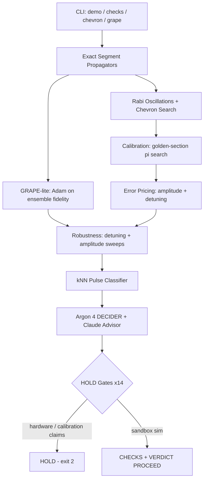
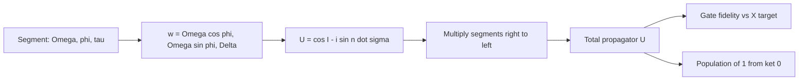
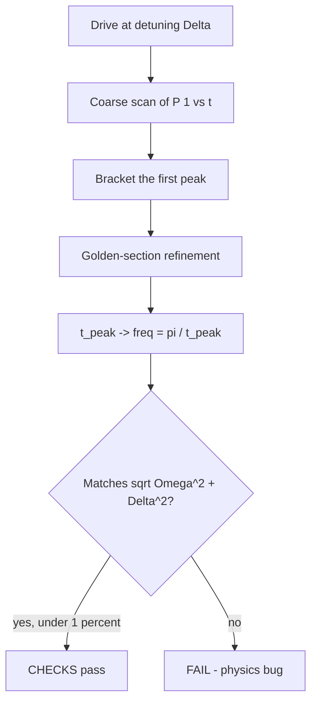
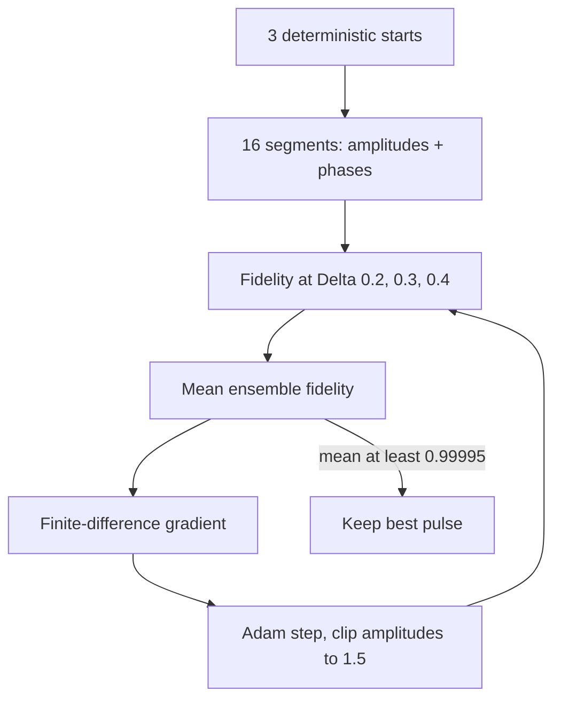
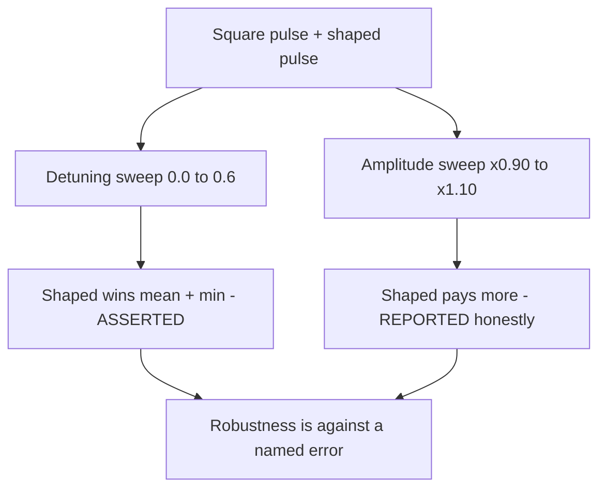
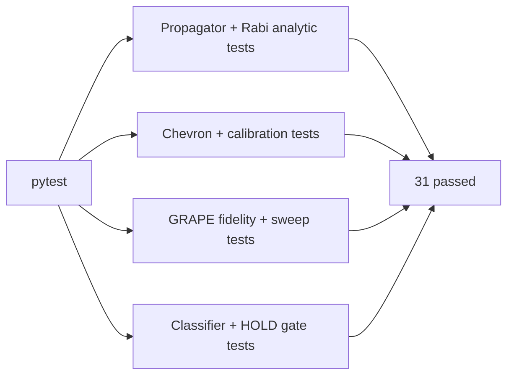
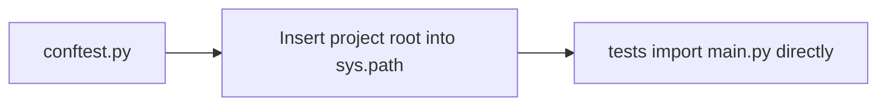
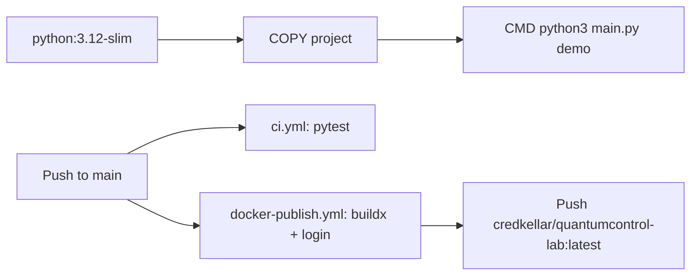

# QuantumControl-Lab 🎛️⚛️

**Quantum Control & Pulse Engineering Lab** — by Darion Kellar

QuantumControl-Lab is an **educational quantum control lab** in ONE pure-Python file. It drives a single qubit with the exact propagator of `H(t) = (Δ/2)σz + (Ω(t)/2)(cos φ σx + sin φ σy)`, measures the **Rabi chevron** instead of quoting it, finds the π-pulse by **search** the way a calibration routine does, prices the classic mistakes (a +5% amplitude mis-set, a detuned plant), and then does the real control-engineering move: a **GRAPE-lite shaped pulse** — 16 segments optimised against a labelled detuning ensemble — that holds fidelity **0.999949** on a plant where the textbook square π-pulse manages **0.9130**.

The honest scope is the whole point, and it is stated everywhere:

- ✅ **What it computes:** exact 2×2 propagator arithmetic in an ideal model, in dimensionless labelled units (Ω₀ = 1, time in 1/Ω₀). Frequencies, fidelities, and sweep tables are derived from the matrices in the code — never quoted from a device datasheet.
- 🚫 **What it can never claim:** a controlled qubit. No pulse here has touched hardware, no device was calibrated, and a 0.999 fidelity in this file is a statement about a matrix product — never a promise about a real gate.

Every hardware / calibration / fault-tolerance / advantage use sits behind a permanent HOLD gate (14 total). 🔒

[](https://github.com/kimanicollier44-cmyk/QuantumControl-Lab/actions/workflows/ci.yml)
[](https://github.com/kimanicollier44-cmyk/QuantumControl-Lab/actions/workflows/docker-publish.yml)

> ℹ️ These are the **live** workflow badges for this repo. They activate as soon as the `ci.yml` and `docker-publish.yml` files from the paste pack are pasted into `.github/workflows/` — until then they have nothing to report yet.

## 🧰 Tech Stack Badges & Full Architecture Tech Stack

### 💻 Core Programming Languages & Core Systems


- 🐍 Python 3.12, pure standard library (`hashlib`, `json`, `math`, `sys`) — zero dependencies, zero network, deterministic (double-run byte-identical)
- 🔢 2×2 complex matrices from scratch — multiply, dagger, trace, matrix-vector — no numpy anywhere, so every propagator can be recomputed by hand
- 🎯 Exact segment propagator: `U = cos(|w|τ/2) I − i sin(|w|τ/2) (n̂·σ)` with `w = (Ω cos φ, Ω sin φ, Δ)` — closed form, zero Trotter error
- 🧠 GRAPE-lite optimiser: deterministic Adam ascent on finite-difference gradients, three fixed starts, amplitudes clipped to the labelled cap Ω ≤ 1.5
- 🏷️ TinyML kNN pulse classifier (from scratch, stdlib): calibrated / mis-set / detuned / robust-optimized from (inversion error, detuning sensitivity, fidelity), labels generated by the lab's own verdict policy
- 🪑 Council seats: Gemini Argon 4 DECIDER (names-only, tighten-only) + Muse advisor (never overrides HOLD) + Google Flow plan-only (rendered = False, live = 0)

### ⛓️ Web3 & Infrastructure

- 🚫 **Not applicable — honestly.** No blockchain, no Web3, no tokens, no quantum network: the "infrastructure" here is one offline Python file computing pulse shapes for a toy qubit. Real quantum-computer operation is a permanent HOLD gate. No fake badges here.

### ⚙️ Platform Support & Hardware Architecture


- 🖥️ Pure Python — runs anywhere Python 3.12+ runs (Linux, macOS, Windows), plus the `python:3.12-slim` Docker image
- 🔒 No hardware is controlled, ever: pulse delivery, device calibration, and cryogenic operation are permanent HOLD gates (see the gate table below)

### ⚡ Low-Level Infrastructure & Performance

- 🚫 **No low-level code — honestly.** No C, no C++, no GPU, no compiled extensions: this is one interpreted Python file on purpose, so every rotation axis, gradient step, and fidelity can be read, checked, and diffed. Performance here means honest algorithms — golden-section peak searches and a capped Adam optimiser — all deterministic and byte-identical between runs.

### 🛠️ DevOps & Build Tools


- 🐳 Docker (`python:3.12-slim`), GitHub Actions CI + Docker Publish (delivered in the paste pack)
- 🎯 Target image: `credkellar/quantumcontrol-lab:latest`
- 🧪 Tests: `pytest` (31 tests) + the built-in CHECKS suite (56 checks) in `main.py`

### ☁️ Cloud Providers

- 🚫 **None — honestly.** No cloud provider is used or needed: the lab runs fully offline on your own machine or in a local Docker container. Docker Hub appears only as the registry the publish workflow pushes the image to.

## What this does?

1. 🧮 **Exact propagators** — a pulse is a list of constant segments; each segment's propagator is the closed-form rotation `cos(|w|τ/2) I − i sin(|w|τ/2)(n̂·σ)`, multiplied exactly. Unitarity is asserted, the zero-drive segment is the identity, and segment order provably matters (non-commuting rotations).
2. 🎢 **Rabi oscillations** — drive |0⟩ and watch it flop. On resonance a π-pulse inverts with P(1) > 1 − 1e-9, a π/2-pulse balances at exactly 0.5, and a 2π-pulse returns to 0 — all asserted against the closed-form Rabi curve to 1e-12.
3. 🏔️ **The chevron, measured** — the lab finds the first peak of the Rabi curve by its own search (coarse scan + golden-section) at Δ = 0 … 2 and reads the frequency off as π/t_peak: 1.0000, 1.0308, 1.1180, 1.4142, 1.8028, 2.2361 — matching √(Ω² + Δ²) to under 1% at every point, while the best transfer falls 1.0000 → 0.2000 exactly as Ω²/(Ω² + Δ²) says.
4. 🔍 **Calibration by search** — the π-pulse duration is *found*, not quoted: the search returns t_π = 3.141593 against the analytic π/Ω₀ = 3.141593, with P(1) = 1.000000000 at the peak.
5. ⚠️ **The +5% mistake, priced** — keep the nominal duration but mis-set the amplitude by +5% (or −5%): P(1) = 0.993844, an inversion error of **0.006156**, symmetric in the sign of the error and asserted against `1 − sin²(1.05π/2)`.
6. 🥴 **The detuned plant** — aim the calibrated square π-pulse at a qubit detuned by Δ = 0.3 (labelled): P(1) and gate fidelity both fall to **0.9130**. A perfect pulse for the wrong qubit is an 8.7%-error gate.
7. 🍇 **GRAPE-lite** — 16 segments over T = 2π, amplitudes capped at 1.5, phases free, optimised by deterministic Adam ascent (three fixed starts) on the *mean* X-gate fidelity over the detuning ensemble {0.2, 0.3, 0.4}: ensemble fidelity **0.999951**, nominal-plant fidelity **0.999949**.
8. 🛡️ **Detuning sweep — the win, asserted** — across Δ = 0.0 … 0.6 the shaped pulse's mean fidelity is **0.997423** vs the square pulse's **0.881762**, and its worst point **0.992255** vs **0.686313**. The square pulse is perfect at Δ = 0 and falls off a cliff; the shaped pulse pays a little at Δ = 0 (0.992255) to never fall at all.
9. 📉 **Amplitude sweep — the price, reported** — scale every amplitude by 0.90 … 1.10 and the shaped pulse drops *harder* than the square (0.863441 vs 0.975528 at ×0.90). Robustness was bought against detuning, and the table says what it cost against amplitude error — reported, not asserted away.
10. 🏷️ **Pulse classifier + seats + checks** — a from-scratch kNN labels the four scenario pulses calibrated / mis-set / detuned / robust-optimized from features the lab measures on its own pulses, watched over by the Argon 4 DECIDER (sha256 trace), Muse advisor, Google Flow plan-only, and a built-in CHECKS suite (56 checks).

## 🗺️ How it works — diagram per script

### `main.py` — the whole lab



### `main.py` § propagators — how a pulse becomes a gate



### `main.py` § chevron — reading the frequency off the curve



### `main.py` § GRAPE-lite — optimising the ensemble average



### `main.py` § robustness — two sweeps, two verdicts



### `tests/test_main.py` — verification



### `conftest.py` — test path setup



### `Dockerfile` + CI flow — container & publish



## Why is this cool?

1. 🎯 The propagator is **exact**: no Trotter steps, no integrator drift — the closed-form rotation is the physics, so a fidelity disagreement is a real disagreement, never numerical noise.
2. 🏔️ The chevron is **measured, not drawn**: the lab finds the peaks itself and the frequencies land on √(Ω² + Δ²) to four decimals — 1.4142 at Δ = 1 is the √2 falling out of a search.
3. 🔍 Calibration works the way the real routine works — **search for the peak** — and it lands on π to six decimals without ever being told π.
4. ⚠️ Both classic mistakes get **receipts**: +5% amplitude costs exactly 0.006156 of inversion; a 0.3 detuning costs 0.087 of fidelity. Same pulse, two different failure prices.
5. 🍇 The GRAPE pulse is a genuine optimisation result: **0.999951 ensemble fidelity** from a from-scratch Adam optimiser in pure stdlib — no scipy, no numpy, no autodiff.
6. 🛡️ The robustness win is **structural**: worst-case fidelity across the sweep improves from 0.6863 to 0.9923 — the shaped pulse doesn't have a cliff edge anywhere in Δ ∈ [0, 0.6].
7. 📉 The amplitude sweep tells the **uncomfortable half**: the detuning-proof pulse is *more* fragile to amplitude error than the naive square. The lab prints it in the same table size as the win.
8. 🧭 The trade is the lesson: robustness is a budget you spend against a **named** error — this lab shows the purchase and the receipt side by side.
9. 🏷️ The classifier's scenarios are **real pulses from the lab**, not hand-typed feature rows: mis-set, detuned, and robust pulses are measured, then labelled.
10. 🎯 Deterministic end to end: three fixed optimiser starts, no randomness anywhere — run it twice, get byte-identical output, GRAPE pulse included.

## What problems this solves?

1. ❌ **Problem:** Textbook Rabi formulas get quoted without ever being computed. ✅ **Solution:** The propagator reproduces the closed-form curve to 1e-12, and the chevron frequencies are extracted by search and asserted against √(Ω² + Δ²).
2. ❌ **Problem:** "Just use a π-pulse" hides what detuning does to a gate. ✅ **Solution:** The detuned-plant report prices it exactly: fidelity 0.9130 at Δ = 0.3 — an 8.7% error gate from a perfectly calibrated pulse.
3. ❌ **Problem:** Amplitude miscalibration is usually discussed as "small". ✅ **Solution:** It is computed, not adjectived: +5% costs 0.006156 inversion error, symmetric in sign, asserted against the analytic value.
4. ❌ **Problem:** Optimal control is treated as library magic (call GRAPE, receive pulse). ✅ **Solution:** The optimiser is 100 lines of readable stdlib — finite-difference gradients, Adam, clipping, three deterministic starts — and its result is re-derived from the reported parameters in the checks.
5. ❌ **Problem:** "Robust pulse" claims rarely name the error they are robust against. ✅ **Solution:** The objective is the ensemble mean over Δ ∈ {0.2, 0.3, 0.4}, stated in code, and the win is asserted only on the detuning sweep.
6. ❌ **Problem:** Robustness trade-offs get hidden. ✅ **Solution:** The amplitude sweep is printed next to the detuning sweep: the shaped pulse loses *more* under amplitude error (0.863441 at ×0.90) — the cost is part of the report.
7. ❌ **Problem:** Simulation fidelities quietly become hardware promises. ✅ **Solution:** Every number is labelled ideal-model, and `guaranteed_hardware_fidelity_claim` is a permanent HOLD gate.
8. ❌ **Problem:** Pulse-shape discussions ignore the amplitude cap real AWGs impose. ✅ **Solution:** The cap Ω ≤ 1.5 is a hard clip inside the optimiser, and the checks assert every segment respects it.
9. ❌ **Problem:** Calibration, control, and verification live in separate tools. ✅ **Solution:** One file runs the whole loop — calibrate, price the errors, optimise, sweep, classify — with one CHECKS suite (56 checks) over all of it.
10. ❌ **Problem:** Toy quantum demos imply a quantum computer is next. ✅ **Solution:** 14 named HOLD gates return exit code 2 for every hardware-delivery, device-calibration, fault-tolerance, or advantage claim, forever.

## How to install this?

1. 📋 Clone or download this project folder.
2. 🐍 Make sure Python 3.12+ is installed: `python3 --version`
3. ▶️ Run the full demo + checks (no arguments needed):

```bash
python3 main.py
```

4. 🧪 Run the test suite:

```bash
pip install pytest
python3 -m pytest -q
```

5. 🎛️ Try the other commands:

```bash
python3 main.py checks    # 56 built-in checks
python3 main.py rabi      # P(1) at the pi time (or pass t and Delta)
python3 main.py chevron   # measured vs analytic Rabi frequencies
python3 main.py calibrate # pi-point search + error pricing
python3 main.py grape     # the optimised pulse: segments + fidelities
python3 main.py robust    # detuning + amplitude sweep tables
python3 main.py classify  # kNN pulse classifier report
python3 main.py brains    # Argon 4 + Muse + Flow seats
python3 main.py holds     # list all 14 HOLD gates
python3 main.py hold-demo # exits 2 - gated actions stay HOLD
```

6. 🐳 Or run it in Docker:

```bash
docker build -t credkellar/quantumcontrol-lab:latest .
docker run --rm credkellar/quantumcontrol-lab:latest
```

## Requirements

- 🐍 Python 3.12 or newer
- 📦 Dependencies: **none** (standard library only)
- 🌐 Network: **none** — fully offline
- 🧪 For tests only: `pytest`
- 🐳 Optional: Docker

## FULL project structure tree

```text
quantumcontrol-lab/
├── main.py                  # the whole lab: exact propagators, Rabi chevron, calibration, GRAPE-lite, robustness sweeps, classifier, seats, HOLD gates
├── conftest.py              # puts the project root on sys.path for tests
├── tests/
│   └── test_main.py         # 31 pytest tests: propagators, Rabi, chevron, calibration, GRAPE, sweeps, gates, determinism
├── assets/
│   └── cover.png            # README cover image (2736 x 912)
├── Dockerfile               # python:3.12-slim, runs the demo
├── .gitignore               # __pycache__/, .pytest_cache/, *.pyc
└── README.md                # this file
```

> 📦 Delivered separately as paste packs (not in this tree): `.github/workflows/ci.yml` + `docker-publish.yml`, and the Docker Hub pack (100-char description, 350-char About, overview, categories).

## 🔒 HOLD gates — all 14, permanent

| # | Gate | What stays held |
|---|------|-----------------|
| 1 | `hardware_pulse_delivery` | No delivering pulses to real quantum hardware from this lab |
| 2 | `real_device_calibration_claim` | No claim that a real device was calibrated by this simulation |
| 3 | `quantum_computer_operation` | No operating a real quantum computer or control stack |
| 4 | `fault_tolerance_claim` | No fault-tolerance or error-correction-threshold claim from a 2x2 toy model |
| 5 | `quantum_advantage_claim` | No quantum advantage or supremacy claim |
| 6 | `guaranteed_hardware_fidelity_claim` | Ideal-model fidelities are never guaranteed on hardware |
| 7 | `commercial_control_product_claim` | No commercial control-software or product claim |
| 8 | `real_qubit_characterization_claim` | No characterising real qubits (T1, T2, frequencies) from simulated numbers |
| 9 | `cryogenic_system_guidance` | No cryogenic or dilution-refrigerator operating guidance |
| 10 | `control_electronics_safety_bypass` | Safety interlocks on real control electronics are never bypassed |
| 11 | `weapons_guidance_claim` | No weapons, guidance, or targeting use of this control math |
| 12 | `medical_device_control_claim` | No medical-device control claims |
| 13 | `investment_claim` | No investment claims; a lab model is not a prospectus |
| 14 | `remove_human_oversight` | Human oversight of any real control system is never removed |

🧑‍⚖️ **Council seats:** Gemini Argon 4 Extended Thinking — DECIDER (names-only, tighten-only, MAP → MODEL → STRESS → DECIDE, sha256 trace, `can_override_hold = False`) · Muse — advisor (`can_override_hold = False`) · Google Flow — plan-only (`rendered = False`, `live = 0`).

✅ **Verification:** pytest **31 passed** (project + clean copy) · built-in CHECKS **56/56** · double-run output **byte-identical** · `hold-demo` exits **2** · `main.py` **871 lines**, pure stdlib, zero network.

## 🧒 5th-grade English section

Imagine a qubit is a **spinning top** that you can tip over with a flashlight beam. 🎯

- Shine the beam for exactly the right time and the top tips all the way over — that is a **π-pulse**. Shine a little too long or too short and it stops partway. This lab finds the "exactly right" time by *trying and measuring*, the same way you would. 🔍
- If the top is a little bit **wobbly** (scientists call that detuning), it spins at a different speed and never tips all the way over, no matter how good your timing is. The lab measures exactly how much wobble costs you. 🥴
- A plain flash of light is a **square pulse**. It works great on a perfect top and badly on a wobbly one. So the lab builds a **shaped pulse**: 16 little flashes, each with its own brightness and colour angle, arranged by a computer search so the wobbly top tips over almost perfectly anyway. 🍇
- Here is the honest part: the shaped flash is *worse* if your flashlight battery is weak. Making something strong against one problem can make it weaker against another — the lab shows both numbers, big and clear. 📉
- This project is a **pretend lab on a computer**. It does not control a real quantum computer. It teaches how scientists aim their pulses, how they fix their aim, and why "almost perfect" always needs a "compared to what?" 💻

---

MIT © 2026 Darion Kellar · QuantumControl-Lab — educational simulation only 🎛️
